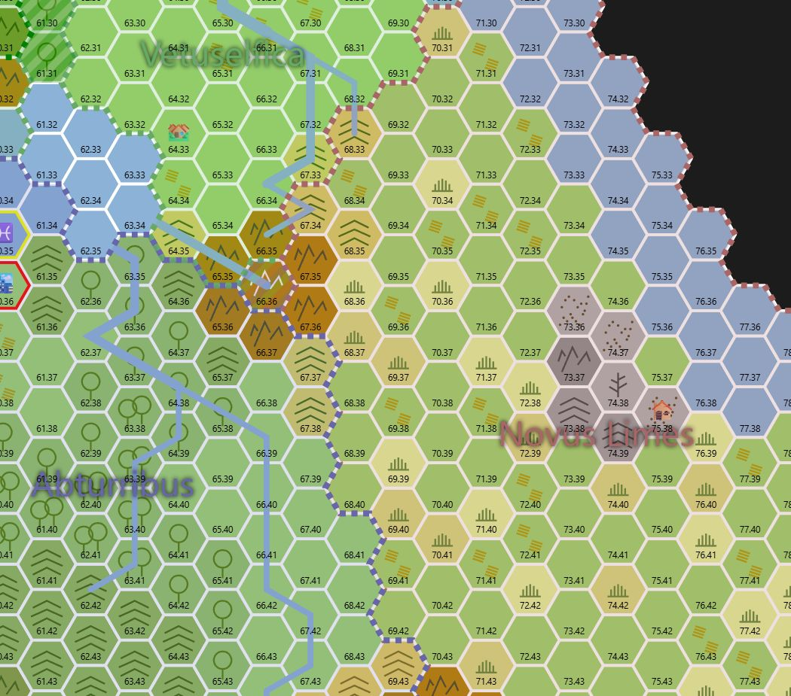

# Hex Map Obsidian Plugin

This plugin adds hex map functionality to Obsidian.



## How to Install

Download the latest release and extract it into your `.obsidian/plugins` folder inside your vault.

## How to Use

### Hex Coordinates

May be specified in `[X, Y]` or `XX.YY` or `XX,YY` format. If you're using the latter two, you will need to quote them inside a `hexMap` block, see below.

### Maps

Declare a `hexMap` block inside a page. Only `key` is required:

    ```hexMap
    key: <KEY>
    centre: "05.05" | this
    maxDistance: 10
    orientation: flat | pointy
    offset: event | odd
    iconKey: icon
    regionKey: parent
    controllerKey: controller
    size: 10
    margin: 5
    coordOffset: 4
    coordSize: 3
    iconSize: 7
    terrainIconSize: 12
    riverWidth: 5
    riverColour: "#8cb2d8"
    borderThickness: 1
    overlayOpacity: 0.4
    zoneColour: silver
    regionOpacity: 0.2
    terrainBg: "#222222"
    terrainFg: "black"
    zoneOpacity: 0.2
    minZoom: 0.5
    maxZoom: 3
    ```

The `key` field is what will match against pages in your vault.

### Hex Keys

Define the following data in your frontmatter:
- key: **required**, coordinates of this hex
- `terrain`: **required**, terrain type
- `controller` or controllerKey: links to entities whose zones of control cover this hex
- `icon` or iconKey: icon to place in centre of hex
- `parent` or regionKey: links to region this belongs to

### Rivers

Define a key`.river` field in your frontmatter of type `list`. Each entry in the list is one of two types:
- `T<number>`: sets thickness of the river from now
- coordinate or hex page link: next hex of river course

### Controllers / Regions

Define the following data in your frontmatter:
- `colour`: fill colour
- `opacity`: fill opacity
